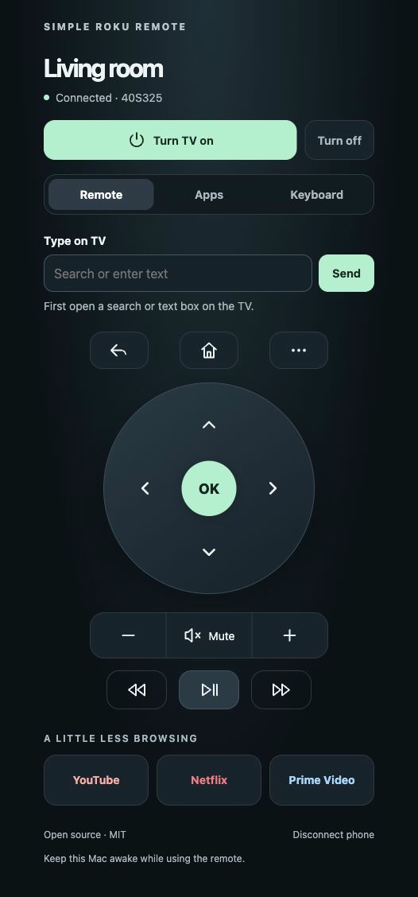

# Simple Roku Remote

A small, open source phone remote for Roku TVs. Open a local web page on your phone, enter a pairing code, and control the TV.

**MIT licensed. Python standard library only. No account, subscription, analytics, cloud relay, or TV installation.**

## What it does

- Directional pad, OK, Home, Back, and Options.
- Volume, mute, play/pause, rewind, and fast forward.
- Separate, clearly labeled Turn TV on and Turn off buttons on supported Roku TVs.
- YouTube, Netflix, and Prime Video shortcuts when installed, plus an installed-app grid.
- HDMI 1/2/3 selection on compatible TVs.
- A Type on TV text box directly on the Remote screen, plus an expanded Keyboard tab with Delete and OK.
- Several phones can pair with the same running remote.

This is a controller for the existing Roku system. It does not replace Roku OS, speed up streaming apps, or stream the TV picture to the phone. Text input and some buttons depend on the TV and foreground app.

## Run without saving project files

Requires Python 3.10 or later on a computer on the same local network as the TV. Find the TV's IPv4 address in Settings > Network > About. Mobile app control must be enabled on the TV.

Replace the example address below with your TV's address:

    curl --fail --silent --show-error --location https://raw.githubusercontent.com/manoj060603/simple-roku-remote/main/remote.py | python3 -B - --tv-host 192.168.1.50 --keep-awake

The source is read into memory. The program does not save application files, configuration, request logs, or typed text. The -B option disables Python bytecode files.

The terminal prints a local URL and a six-digit pairing code:

1. Connect your phone, computer, and TV to the same local Wi-Fi network.
2. Open the printed http:// address in your phone's browser.
3. Enter the pairing code.
4. Tap Turn TV on to wake a TV in standby. The app shows Waking TV and briefly holds queued controls while it wakes.
5. To type, first open a search or text field on the TV. Enter words in Type on TV on the Remote screen, then tap Send. The Keyboard tab also offers Delete and Press OK on TV. Text entry depends on the TV app.
6. Optionally add the page to your phone's Home Screen.

Keep the computer running. On macOS, --keep-awake prevents idle system sleep while this process is running; it does not prevent the display from sleeping. Press Ctrl+C in the terminal to stop the remote. Restarting generates a new pairing code and clears sessions.

The default port is 8765. Use --port to choose another port, or --bind to choose a specific local interface. By default it listens only on the interface used to reach the TV. The TV address is supplied at runtime and is never stored in this repository.

## Pairing and network behavior

A pairing code is required before status or TV controls are available. Each phone gets an HttpOnly, SameSite=Strict session cookie, valid for up to 12 hours while the process remains running. Disconnect phone revokes that session.

The server permits a fixed set of TV commands and installed-app launches; it is not a generic HTTP proxy or file server. Pairing attempts and control requests are limited. Host and Origin checks, a custom request header, and a content security policy limit cross-site use.

The local page uses HTTP, so pairing and control traffic are not encrypted. Use it on a trusted local network. It is not intended for public internet hosting or port forwarding.

## Troubleshooting

- **Phone cannot open the page:** check that the computer is awake and on the same network. Allow incoming connections for Python if your computer's firewall asks. Guest networks may isolate devices.
- **TV unavailable:** confirm its address and Wi-Fi connection. Wake the TV with Turn TV on before other commands. Network wake availability depends on the TV's power settings.
- **Controls rejected:** check Settings > System > Advanced system settings > Control by mobile apps. Menu names vary by Roku version.
- **Typing has no effect:** first select a text field on the TV. Not every streaming app supports Roku's literal-text input.
- **Connection times out:** check the TV before repeating a command; a timed-out request may already have reached it.
- **Computer or server restarts:** run the program again, open its new printed address if changed, and pair again.

## Development and validation

Source is a single file, remote.py, including the mobile HTML/CSS/JavaScript. test_remote.py uses an in-memory fake TV and ephemeral loopback server. It does not contact a real TV.

    python3 -B -m unittest -v

Tests cover pairing, rate limits, cookie behavior, logout, cross-site/Host rejection, permitted commands, installed-app restrictions, Unicode text encoding, and private-address validation.

The initial version was also checked in a 390 x 844 browser layout and against a TCL 40S325: pairing, power-on, YouTube launch, and returning Home were verified. This is not a claim that every Roku model or app has been tested.

Project work for the initial owner is kept directly on GitHub. The tonight session was run from memory without creating local project files or downloads.

## References and license

- [Roku External Control Protocol](https://developer.roku.com/dev/docs/external-control-api)
- [Roku mobile network control guidance](https://support.roku.com/article/connect-your-phone-to-a-roku-tv-system-or-streaming-player)

Copyright (c) 2026 Manoj. See LICENSE.

Independent project, not affiliated with Roku.
