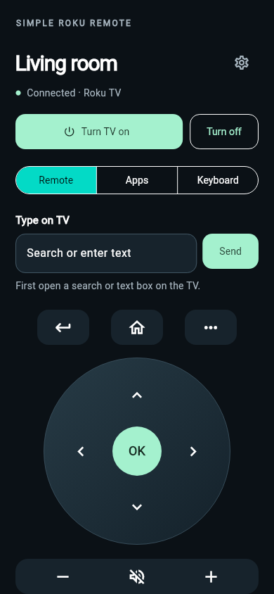

# Simple Roku Remote

An open source Android app that controls Roku TVs directly over Wi-Fi. Your phone is the remote: no laptop, server, account, or pairing code is needed while using the installed app.

**[Download Android APK](https://github.com/manoj060603/simple-roku-remote/releases/download/v0.2.0/simple-roku-remote-android.apk)** · [Release notes and checksums](https://github.com/manoj060603/simple-roku-remote/releases/tag/v0.2.0) · [Source and build instructions](mobile/README.md)

## Start watching

1. Download and install the APK on your Android phone.
2. Connect the phone and TV to the same Wi-Fi.
3. Enter the TV's address from Settings > Network > About.
4. Use Turn TV on, the directional pad, Home, volume, playback, or app shortcuts.
5. For typing, first open a search/text field on the TV, enter words in Type on TV, and tap Send. Keyboard also offers Delete and OK.

The app remembers the TV address on the phone. Several phones can connect independently. It works with Roku's existing apps and operating system. Text input, HDMI inputs, volume, and network wake depend on the TV and foreground app. The TV must remain plugged in and network-reachable for power-on.

## Open source and privacy

MIT licensed, with a small Flutter codebase under mobile/. No advertising, telemetry, cloud relay, or TV installation. Only the TV address is saved in phone preferences; typed text is not saved.

Roku control uses unencrypted HTTP on the local network. Use trusted Wi-Fi and do not expose the TV's ECP port to the internet.

The Android package is built and signed on Virginia Tech ARC. Shared client and widget checks use fake TVs and local HTTP servers; the release has not yet been tested on a physical Android phone. See the release's build manifest and SHA256SUMS for artifact provenance.

## Optional browser controller

The earlier Python/browser remote remains available in remote.py. It **requires the computer running it to stay awake**. [Browser-controller instructions](docs/BROWSER-CONTROLLER.md) are separate from the standalone Android app.

## Development

[Build instructions, platform details, and tests](mobile/README.md). The iPhone build is available as a manual developer workflow; it is not part of the Android download.

Independent project, not affiliated with Roku. Copyright (c) 2026 Manoj. See [LICENSE](LICENSE).
